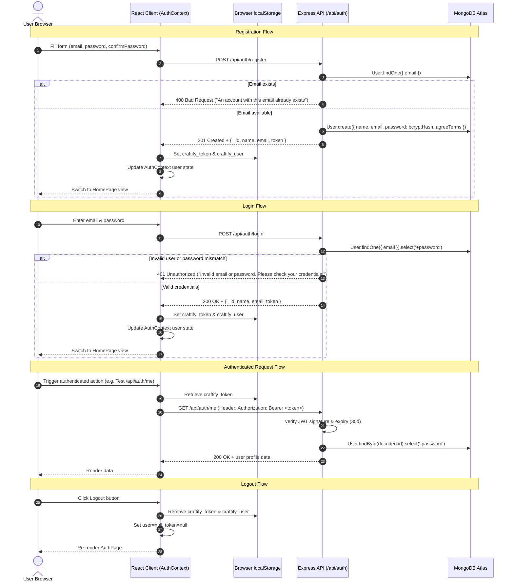

# Craftify Labs - System Architecture

## 1. Folder Structure Overview

The repository is structured as a decoupled client-server architecture containing two primary directories (`Frontend/` and `Backend/`), with zero shared build packages currently defined.

```
d:/Ai-web-builder/
├── .gitignore                     # Repository-level ignore rules (node_modules, .env, build output)
├── README.md                      # Root setup, runtime requirements, and developer guide
├── docs/                          # System documentation and verification reports
│   ├── ARCHITECTURE.md            # Technical architecture, endpoints, and stack audit
│   ├── AUTH_SMOKE_TEST.md         # Auth smoke test matrix and manual test protocol
│   └── OWNERSHIP_PLAN.md          # Multi-tenant resource ownership and authorization plan
├── Backend/                       # Node.js + Express + MongoDB REST API
│   ├── .env                       # Local environment variables (untracked)
│   ├── .env.example               # Template environment configuration
│   ├── .gitignore                 # Backend-specific ignore rules
│   ├── config/
│   │   └── db.js                  # Mongoose MongoDB connection initializer
│   ├── controllers/
│   │   └── authController.js      # Handlers for register, login, and getMe
│   ├── middleware/
│   │   ├── authMiddleware.js      # JWT verification and req.user attachment
│   │   └── errorMiddleware.js     # Global error format and Mongoose error handling
│   ├── models/
│   │   └── User.js                # Mongoose User schema (bcrypt pre-save hook)
│   ├── routes/
│   │   └── authRoutes.js          # /api/auth routes
│   ├── package.json               # Backend dependencies and scripts
│   └── server.js                  # Express application setup and entrypoint
└── Frontend/                      # React 19 + Vite + Tailwind CSS v4 Single Page App
    ├── .env.example               # Client environment template
    ├── .gitignore                 # Frontend-specific ignore rules
    ├── index.html                 # HTML5 entrypoint template
    ├── package.json               # Client dependencies and scripts
    ├── vite.config.js             # Vite configuration with React and Tailwind plugins
    ├── public/                    # Static assets, branding logos, and imagery
    └── src/
        ├── main.jsx               # React DOM entrypoint
        ├── App.jsx                # Root router / auth condition switch
        ├── index.css              # Global styles & Tailwind v4 theme configuration
        ├── components/            # UI components
        │   ├── AuthCard.jsx       # Login & Registration tabbed card
        │   ├── InputField.jsx     # Form input wrapper with visibility toggles
        │   ├── Toast.jsx          # Notification banner component
        │   ├── DashboardView.jsx  # (Unused/Legacy) Dashboard preview card
        │   ├── GlassPanel.jsx     # (Unused/Legacy) Frosted glass container
        │   └── RetroMonitor.jsx   # (Unused/Legacy) CRT terminal decorative monitor
        ├── context/
        │   └── AuthContext.jsx    # React Context managing session & user state
        ├── pages/
        │   ├── AuthPage.jsx       # Public authentication landing page
        │   └── HomePage.jsx       # Authenticated home view & auth diagnostic console
        └── services/
            └── api.js             # Client HTTP service & localStorage token manager
```

---

## 2. Tech Stack and Versions

| Layer | Technology | Version | Purpose |
| :--- | :--- | :--- | :--- |
| **Runtime** | Node.js | `>= 20` (tested `v24.11.1`) | Server-side JavaScript runtime |
| **Package Manager** | npm | `11.6.2` | Dependency management |
| **Backend Framework** | Express | `5.3.0` | HTTP application server & routing |
| **Database & ODM** | MongoDB / Mongoose | `9.11.1` | NoSQL document database and schema modeling |
| **Auth & Security** | `jsonwebtoken` / `bcryptjs` | `9.0.3` / `3.0.3` | JWT issuance/verification & salted password hashing |
| **CORS Middleware** | `cors` | `2.8.6` | Cross-origin resource sharing |
| **Frontend Framework** | React | `19.2.0` | Client component architecture |
| **DOM Renderer** | React DOM | `19.2.0` | React web renderer |
| **Bundler & Dev Server**| Vite | `7.2.4` / `7.3.7` | Client dev server and production builder |
| **Styling** | Tailwind CSS / `@tailwindcss/vite` | `4.3.3` | Modern utility-first CSS |
| **Icons** | `lucide-react` | `1.54.0` | SVG UI icon library |
| **Routing** | State-based conditional rendering | N/A | Evaluates `user ? <HomePage /> : <AuthPage />` |
| **State Management** | React Context (`AuthContext`) | Native React | Application session and authentication state |

---

## 3. Routes & Endpoints

### Backend REST API

| Method | Path | Protected | Handler | Purpose |
| :--- | :--- | :--- | :--- | :--- |
| `GET` | `/api/health` | **Public** | Inline (`server.js`) | Liveness check; returns API status, version, and server timestamp |
| `POST` | `/api/auth/register` | **Public** | `registerUser` | Registers new user account with hashed password and returns JWT token |
| `POST` | `/api/auth/signup` | **Public** | `registerUser` | Alias for `/api/auth/register` |
| `POST` | `/api/auth/login` | **Public** | `loginUser` | Validates credentials and returns JWT token and user profile |
| `GET` | `/api/auth/me` | **Protected** (`protect`) | `getMe` | Fetches authenticated user's profile (`_id`, `name`, `email`, `createdAt`) |
| `*` | Any undefined path | **Public** | Fallback (`server.js`) | Returns 404 with JSON message: `API endpoint {url} not found` |

### Frontend Client Views (State-based Navigation)

| View Condition | Component | State Guard | Purpose |
| :--- | :--- | :--- | :--- |
| `user === null` | `<AuthPage />` | Public (Unauthenticated) | Displays login / signup forms |
| `user !== null` | `<HomePage />` | Protected (Authenticated) | Displays user dashboard, token inspector, and builder placeholder |
| `loading === true`| Fullscreen Loader | Transient | Shows spinner while checking `localStorage` on initial mount |

---

## 4. Database Schema & Data Models

### Engine
**MongoDB** (connected via Mongoose ODM).

### Collections
1. **`users`** (Model: `User`, defined in `Backend/models/User.js`)

| Field Name | BSON Type | Constraints & Defaults | Description |
| :--- | :--- | :--- | :--- |
| `_id` | `ObjectId` | Primary Key, Auto-generated | Immutable unique identifier for the user |
| `name` | `String` | Trimmed, default: `'Craftify Creator'` | Display name |
| `email` | `String` | Required, unique, lowercase, trimmed, regex validated | Account email address |
| `password` | `String` | Required, minlength: 6, `select: false` | Bcrypt password hash (10 salt rounds) |
| `agreeTerms` | `Boolean` | Default: `true` | Terms acceptance flag |
| `createdAt` | `Date` | Auto-managed via `timestamps: true` | Account creation timestamp |
| `updatedAt` | `Date` | Auto-managed via `timestamps: true` | Last profile update timestamp |

### Sessions Collection
There is **no** server-side sessions collection. Authentication is stateless using signed JSON Web Tokens.

---

## 5. End-to-End Authentication Flow



### Credential & Token Lifecycle
1. **Token Storage**: `localStorage` under key `craftify_token`. User summary is cached under `craftify_user`.
2. **Token Expiry**: Fixed at `30d` (`expiresIn: '30d'` in `generateToken`).
3. **Token Refresh**: No silent refresh or refresh token mechanism is implemented; once expired, user must log in again.
4. **Credential Transmission**: Attached on all outgoing HTTP calls in `Frontend/src/services/api.js` via `Authorization: Bearer <token>` header.
5. **Session Hydration**: On application reload, `AuthContext` runs a mount `useEffect` to read `craftify_token` and `craftify_user` from `localStorage`, instantly restoring user state without a blocking network round-trip.

---

## 6. Environment Variables

| Variable Name | Location | Required? | Purpose | Placeholder Example |
| :--- | :--- | :--- | :--- | :--- |
| `PORT` | `Backend/.env` | Optional (default: `3000`) | Port on which the Express server listens | `3000` |
| `MONGO_URL` | `Backend/.env` | **Required** | MongoDB connection string URI | `mongodb+srv://<username>:<password>@cluster.mongodb.net/craftify_db?retryWrites=true&w=majority` |
| `JWT` | `Backend/.env` | Recommended | Primary secret key used to sign and verify JWTs | `replace_with_a_secure_random_64_character_hex_secret` |
| `JWT_SECRET` | `Backend/.env` | Alternative | Secondary fallback secret variable name | `replace_with_a_secure_random_64_character_hex_secret` |
| `VITE_API_URL`| `Frontend/.env`| Optional | Base URL for backend API in client requests | `http://localhost:3000/api` |

---

## 7. Build, Dev, and Deployment Commands

### Backend (`Backend/`)
- **Development**: `npm run dev` (runs `node --watch server.js` with native ESM hot reload)
- **Start (Production)**: `npm start` (runs `node server.js`)
- **Lint / Build**: No compilation step required (native Node.js ES Modules)

### Frontend (`Frontend/`)
- **Development**: `npm run dev` (starts Vite dev server on `http://localhost:5173`)
- **Production Build**: `npm run build` (outputs optimized bundle to `Frontend/dist/`)
- **Preview Production Build**: `npm run preview` (previews `dist/` build locally)
- **Code Quality**: `npm run lint` (runs ESLint with React flat configuration)

---

## 8. Findings: Architectural Risks, Code Smells & Defects

1. **[FIXED] Catastrophic ReDoS in Email Regex (`Backend/models/User.js`)**:
   - *Original*: `/^\w+([.-]?\w+)*@\w+([.-]?\w+)*(\.\w{2,3})+$/`
   - *Problem*: Nested repetitions `([.-]?\w+)*` combined with a strict 2-3 char TLD restriction created exponential catastrophic backtracking on emails ending in non-standard or 4+ letter TLDs (e.g., `.test`, `.online`, `.cloud`), completely freezing the Node.js event loop with 100% CPU lock.
   - *Resolution*: Replaced with linear-time safe regex `/^[a-zA-Z0-9._%+-]+@[a-zA-Z0-9.-]+\.[a-zA-Z]{2,}$/`.
2. **Insecure Fallback JWT Secret**:
   - In `Backend/controllers/authController.js` and `Backend/middleware/authMiddleware.js`, if neither `JWT` nor `JWT_SECRET` is defined, the code defaults to `'craftify_fallback_secret_key_2026'`. A missing environment variable will fail open with a publicly known secret.
   - *Recommendation*: Fail fast on startup if no secret is defined in production.
3. **Hardcoded API URL in Client (`Frontend/src/services/api.js`)**:
   - `const API_BASE_URL = 'http://localhost:3000/api';` is hardcoded. It does not use `import.meta.env.VITE_API_URL`.
   - *Risk*: Prevents deployment to staging/production without editing source code.
4. **Permissive CORS Configuration (`Backend/server.js`)**:
   - `cors({ origin: '*', credentials: true })` allows wildcard origins.
   - *Risk*: Wildcard CORS paired with `credentials: true` is non-standard and rejected by standard browsers when credentials mode is `include`. For production, origin should be constrained to trusted client hosts.
5. **No Rate Limiting on Auth Routes**:
   - No rate limiting middleware exists on `/api/auth/login` or `/api/auth/register`. Rapid brute-force login attempts receive consecutive 401s without throttling (HTTP 429).
6. **Stateless JWT Invalidation on Logout**:
   - Logout clears credentials on the client (`localStorage`), but the token is not added to a server-side revocation list. Tokens remain valid for their full 30-day lifetime until expiration.
7. **No Formal Frontend Router**:
   - The application does not use `react-router-dom`. Navigation between auth and dashboard is governed solely by `user ? <HomePage /> : <AuthPage />`. Adding multiple routes (e.g. editor, project settings, dashboard) in subsequent phases will require a structured routing solution.
8. **Orphaned / Unused UI Components**:
   - `DashboardView.jsx`, `GlassPanel.jsx`, and `RetroMonitor.jsx` exist in `Frontend/src/components/` but are never imported or rendered.
